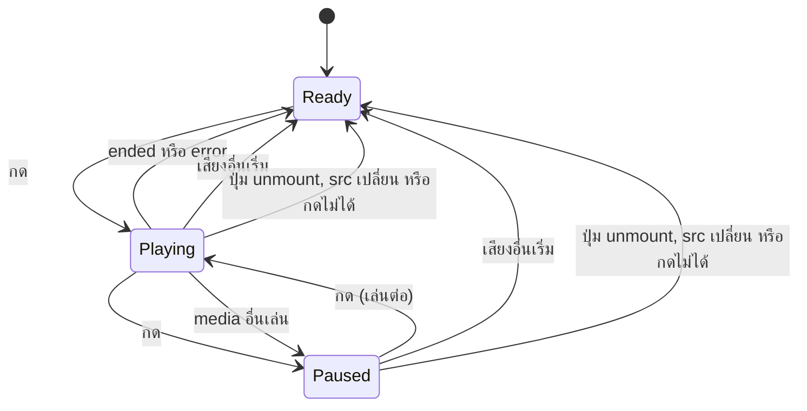
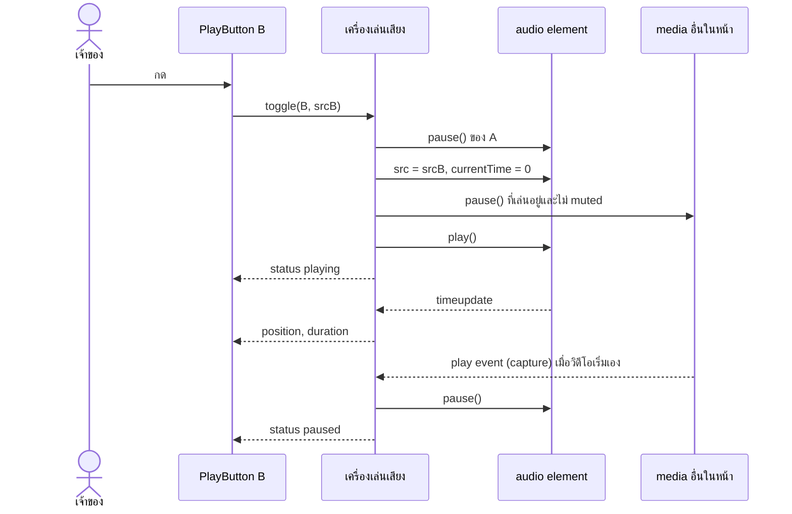
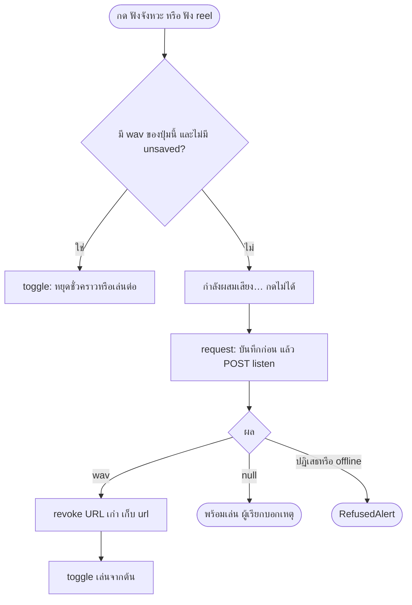

# Flow: audio-player

3 diagrams, read in this order:
1. สถานะของ `PlayButton` หนึ่งปุ่ม
2. กดปุ่ม B ขณะปุ่ม A เล่นอยู่
3. ปุ่มผสมเสียง (`useListen`)

All diagrams use the same names as [spec.md](spec.md).

## 1. สถานะของปุ่มหนึ่งปุ่ม

**ปุ่มอยู่สถานะไหนและกดแล้วไปไหน**
- Ready หลังเสียงอื่นเริ่มลืมตำแหน่ง: กดแล้วเริ่มจากต้น (D2).
- media อื่น (วิดีโอ เพลงต้นฉบับ) ทำให้หยุดชั่วคราว ไม่ลืมตำแหน่ง (D8).
- `play()` reject ในรอบปัจจุบันกลับ Ready โดยไม่มีข้อความ; `AbortError` และรอบเก่าไม่มีผล (D9, D13).
- Playing เริ่มทันทีที่เรียก `play()` ไม่รอ Promise; กดระหว่างนั้น = หยุดชั่วคราว (D13).

## 2. กดปุ่ม B ขณะ A เล่นอยู่

**ทำไมไม่มีวันเล่นซ้อน**
- `audio` element มีตัวเดียว: เปลี่ยน `src` ทำให้เสียงเดิมหายแน่นอน (D1).
- `pause()` ของ A ถูกเรียกก่อน `play()` ของ B; seam 1 พิสูจน์ลำดับนี้ (D12).
- element ของเครื่องเล่นไม่อยู่ใน document: เครื่องเล่น pause media อื่นเองใน `toggle`; capture listener มีไว้ให้ media อื่นทำให้เครื่องเล่นหยุด (D8, D13).
- วิดีโอเริ่มเล่นก็หยุดวิดีโออื่นที่เล่นอยู่ด้วยกฎเดียวกัน (D13).

## 3. ปุ่มผสมเสียง

**ผสมเมื่อไรและเมื่อไรแค่ pause**
- แก้ค่าขณะฟัง (`unsaved`) → `release` ปุ่มกลับพร้อมเล่น และทิ้ง wav (D14).
- แกะใหม่ของ reel cover เปิดฟอร์มใหม่ จึงไม่มี wav เก่าค้าง (D14).
- request เดิมไม่เปลี่ยน: บันทึกก่อน แล้ว `POST …/listen` (D11, video-gen D29).
