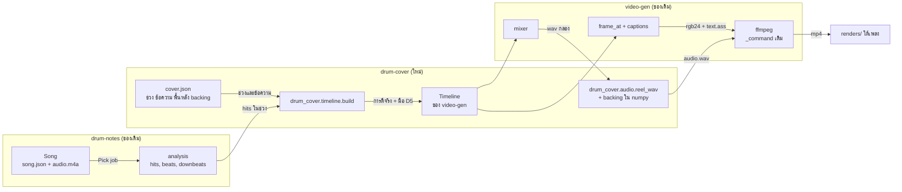
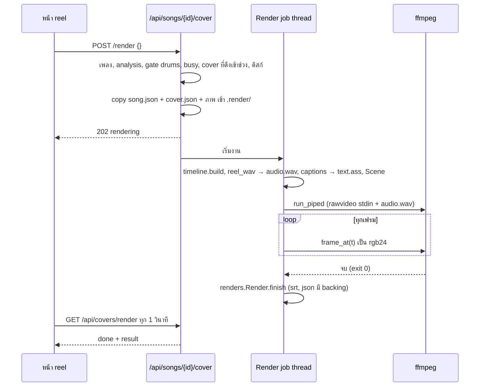
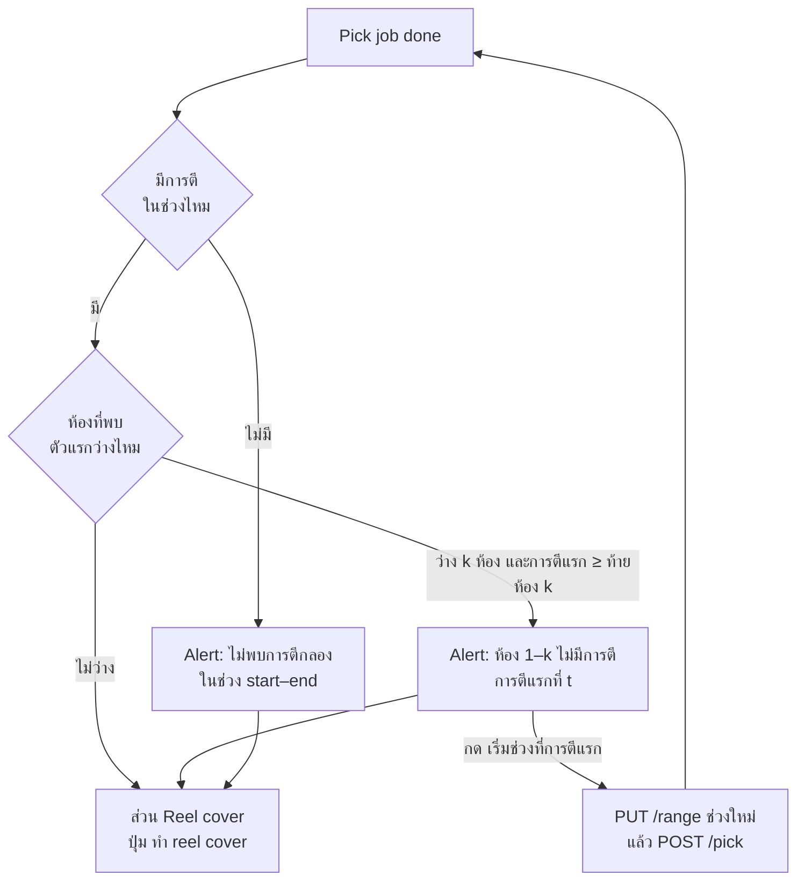

# Flow: drum-cover

3 diagrams, read in this order:
1. ทางเดินจากเพลงที่แกะไปเป็น reel: อะไรของเดิม อะไรของใหม่
2. Render job ของ reel ตั้งแต่กดจนได้ไฟล์ และเสียง backing เข้าตรงไหน
3. หน้าเพลงหลังแกะ: เมื่อไรบอกว่าช่วงไม่มีกลอง

All diagrams use the same names as [spec.md](spec.md).

## 1. จากเพลงที่แกะไปเป็น reel

**reel ใช้ของเดิมสองข้าง: `analysis` จาก drum-notes เข้า และ mixer/frames ของ video-gen ออก; ของใหม่คือ `cover.json` กับตัวแปลงเป็น `Timeline`**
- บทเรียนกลอง (`drum_notes.lesson` → `video_gen.lessons`) ยังอยู่เป็นทางออกที่สองของ `analysis` ไม่อยู่ในภาพ (D1, D11)
- `Timeline` ตัวเดียวขับทั้งเสียงและภาพ reel จึงตรงกันเท่าคลิปสอน (D4, ADR-0041, ADR-0051)
- backing ผสมใต้กลองใน `reel_wav` ทางเดียวที่ทั้งฟังและ render ใช้; คำสั่ง ffmpeg ของ video-gen ไม่แก้ (D17, ADR-0050)
- Lesson ชั่วคราวหนึ่งท่อนถือหัวเรื่อง บรรทัดรอง คำบรรยาย พื้นหลัง ให้ `frames` และ `captions` อ่าน (D4)
- `cover.json` และ `renders/` อยู่ใน folder ของเพลงและหายตามเพลง (D2)

## 2. Render job ของ reel

**ระหว่างกด render จนได้ไฟล์ เกิดอะไรตามลำดับ และ backing เข้าทาง `audio.wav` ไม่ใช่ทาง `Timeline`**
- การตรวจทั้งหมดเกิดก่อน `202`; ลำดับและ error code อยู่ใน spec › Render job (D12)
- backing ปิด: `audio.wav` = เสียงกลอง; เปิด: `reel_wav` ถอด `audio.m4a` ช่วง `[start_s, end_s)` ผสมใต้กลองแล้ว peak −1 dBFS (D7, D17)
- รันพร้อม Render job ของสอนกลองและ Pick job ได้ (D20)
- งานใช้สำเนาใน `media/songs/.render/`; `PUT /cover` ระหว่างงานถึงงานถัดไป (D12)
- ลบเพลงระหว่างงาน → `409` `song_busy`; `audio.m4a` จึงอ่านที่เดิมได้ (D2, D12)
- state `rendering` → `done` | `failed` | `cancelled` เหมือน Render job ของ video-gen (D12)

## 3. หน้าเพลงหลังแกะ

**หลังแกะ หน้าเพลงบอกสามแบบ: ไม่มีกลองเลย, กลองเข้าช้า, หรือปกติ; ทุกแบบยังมีส่วน Reel cover (ไม่มีการตี: หน้า reel กันฟังและ render, D18, D19)**
- ทุกค่าคำนวณบนหน้าเว็บจาก `bars[].hits` และ `analysis.hits` ไม่มี API ใหม่ (D9)
- ช่วงใหม่ = ต้นห้องแรกที่มีการตี (ปัดลง 0.1) ถึง + ความยาวเดิม จำกัดที่ `duration_s` (D9)
- ลูป `Repick → Done` คือ Pick job รอบใหม่ ซึ่งแสดงแถบ % ตามเดิมของ drum-notes
- ส่วน "สร้างบทเรียน" ยังอยู่ใต้ส่วน Reel cover ไม่อยู่ในภาพ (D11)
