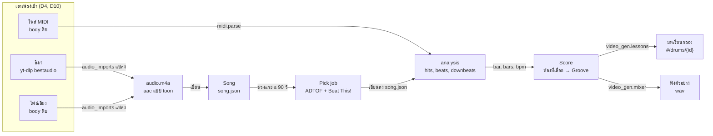
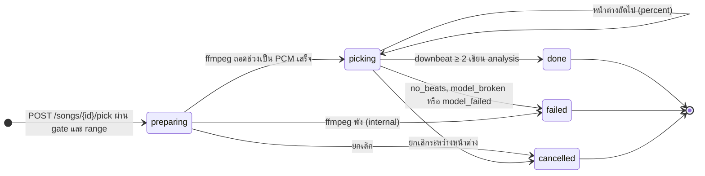
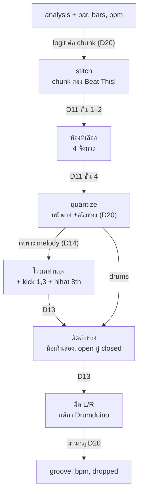

# Flow: drum-notes

3 diagrams, read in this order:
1. ทางเดินทั้ง tab: เพลงเข้าสามทาง กลายเป็นบทเรียนกลองได้อย่างไร
2. สถานะของ Pick job ตั้งแต่กดแกะจนได้ `analysis`
3. Score: จาก `analysis` กับห้องที่เลือก เป็น Groove ที่ผ่านกฎ video-gen D20

All diagrams use the same names as [spec.md](spec.md).

## 1. ทางเดินทั้ง tab

**เพลงจากทุกทางมาบรรจบที่ `analysis` รูปเดียว แล้วใช้ Score ร่วมกันสร้างบทเรียน**
- MIDI ข้าม Pick job: การตีทั้งไฟล์คือ `analysis` ตั้งแต่เอาเข้า (D10)
- งานลิงก์และไฟล์ใช้ `backend.audio_imports` ร่วมกับคลังเสียง (`backend.sounds`; เดิมคลังเสียงพื้นของ toon, D20)
- เสียงเพลงจบที่ Pick job และ player; ไม่ไปถึงบทเรียนหรือคลิป (D15)
- ลิงก์หรือไฟล์ที่ซ้ำ (id เดิม) ชี้ Song เดิมโดยไม่โหลดใหม่ (D3)
- `lessons` ของ Song จำ id ที่สร้าง; `lesson.json` ไม่รู้จักเพลง (D12)

## 2. สถานะของ Pick job

**งานเดียวทั้ง tab รันใน thread ไม่จองช่อง GPU และจบด้วยหนึ่งในสามปลายทาง**
- `busy` ตอบก่อนเข้า `preparing` เมื่องานอื่นยังไม่จบ (D18)
- ยกเลิกเช็คก่อนเริ่มแต่ละโมเดลและระหว่าง chunk ของ Beat This!; ADTOF ป้อนทั้งช่วงครั้งเดียว จึงยกเลิกระหว่างนั้นไม่ได้ (D18, D20)
- `failed` และ `cancelled` ไม่แตะ `analysis` เดิม; `done` ทับทั้งก้อน (D6)
- restart ระหว่างงาน: งานหาย `analysis` เดิมอยู่ (D18)
- โหมดทำนองใช้ state เดียวกัน แต่ `picking` รัน Basic Pitch แทน ADTOF (D14)

## 3. Score

**Score เป็นเลขล้วน: input คือ `analysis` กับสามตัวเลข output คือ Groove ที่ `PUT` ของ video-gen รับได้**
- ห้องที่จังหวะไม่ครบ 4 เลือกไม่ได้; BPM = 240 / มัธยฐานความยาวห้องที่เลือก (D20)
- ชิ้นเดียวกันซ้ำช่องเดียวกันเหลือตัวที่ `level` สูงสุด ก่อนขั้นตัด (D11)
- การตีอยู่ในห้องที่หน้าต่าง `[downbeat − ช่อง/2, downbeat ถัดไป − ช่อง/2)` ครอบ; ช่อง `16 × bars` ทิ้งและไม่นับใน `dropped` (D20)
- `dropped` เป็นรายการ `{piece, step}` ให้ผู้ใช้เติมกลับในหน้าแก้ (D20)
- `POST /preview`, `POST /listen` และ `POST /lessons` เรียกทางเดียวกัน ต่างแค่ขั้นสุดท้าย: คืน Groove, ผสม wav จากบทเรียนชั่วคราว, หรือเขียนบทเรียน (D12, D21)
