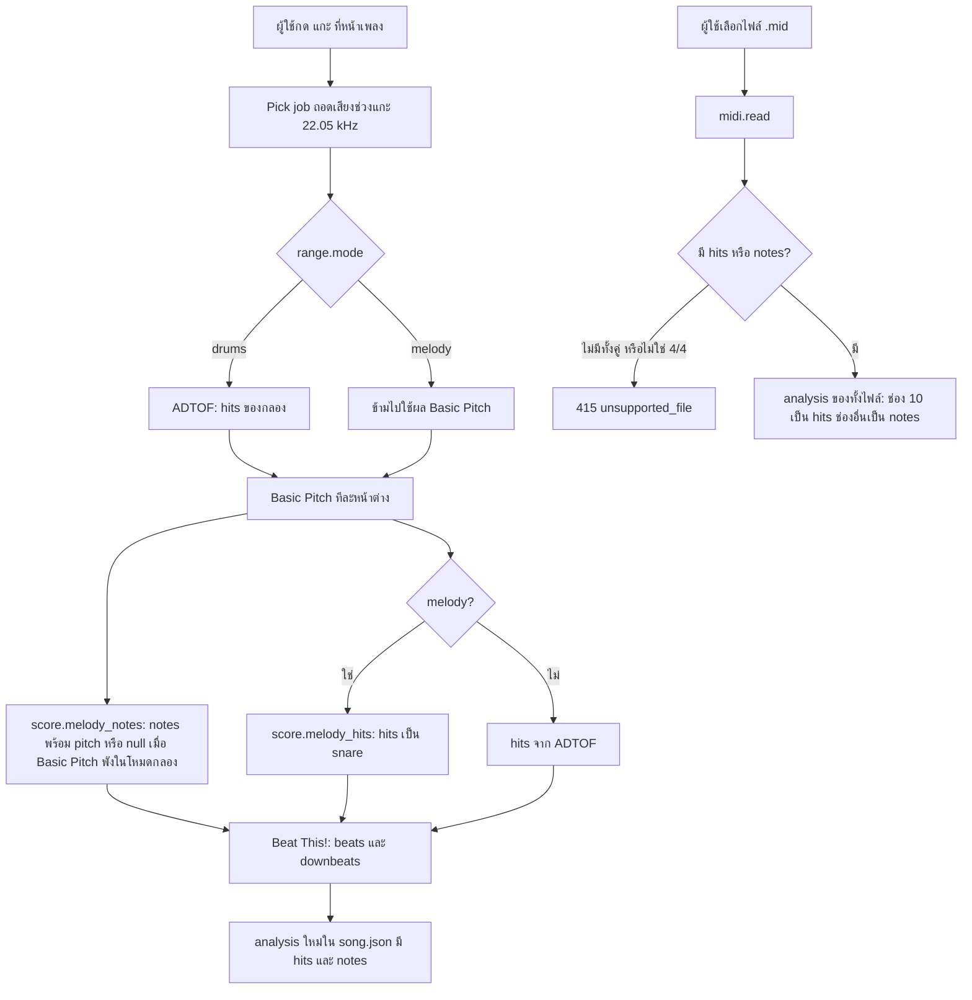
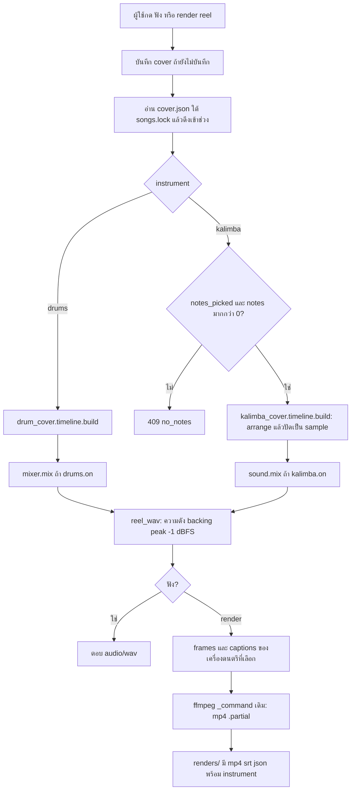

# Flow: kalimba-cover

2 diagrams, read in this order:
1. โน้ตทำนองเข้า Song ได้สองทาง: Pick job และไฟล์ MIDI
2. ฟังและ render reel เลือกทางตาม `instrument`

All diagrams use the same names as [spec.md](spec.md).

## 1. โน้ตทำนองเข้า Song

**analysis หนึ่งชุดมีทั้งการตีกลองและโน้ตทำนองได้อย่างไร**
- Basic Pitch รันครั้งเดียวต่อ Pick job ทั้งสองโหมด; พังในโหมดกลองไม่ทำให้งานพัง (D2, D14)
- ไฟล์ MIDI เดิมของเพลงที่ `notes` `null` นำเข้าซ้ำ → เติม `notes` ตอบเพลงเดิม (D14)
- `percent` ของ Pick job นับหน้าต่าง Basic Pitch ทุกโหมด (D2)
- `song.json` ที่แกะก่อน feature นี้ไม่มี `notes`: อ่านเป็น `null` ไม่ใช่ `[]` (D2)
- MIDI ยังต้องเป็น 4/4 tempo แรก ความยาว = ตัวสุดท้าย + 1 ห้อง (D3)

## 2. ฟังและ render reel ตามเครื่องดนตรี

**เสียงกับภาพของแต่ละเครื่องดนตรีอ่านจากไหน**
- ทุกเวลาของคาลิมบามาจาก `KalimbaTimeline`; ของกลองมาจาก `Timeline` เดิม (D6, ADR-0041)
- ลำดับ error ของ render: `404`/`no_analysis` → อ่าน cover (`400`) → `no_notes` → gate ตาม `instrument` (`503`) → `busy` → `507` (spec › Render job, D14)
- Render job slot เดียวสำหรับทั้งสองแบบ: งานซ้อน `409` `busy` (D8)
- ห้ามเงียบตรวจที่ `PUT` และอีกครั้งที่ `listen`/`render` สำหรับไฟล์ที่แก้มือ (D9, drum-cover D24)
