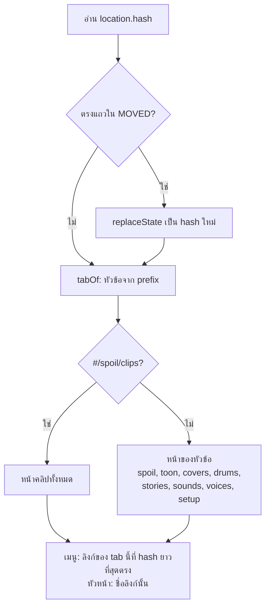
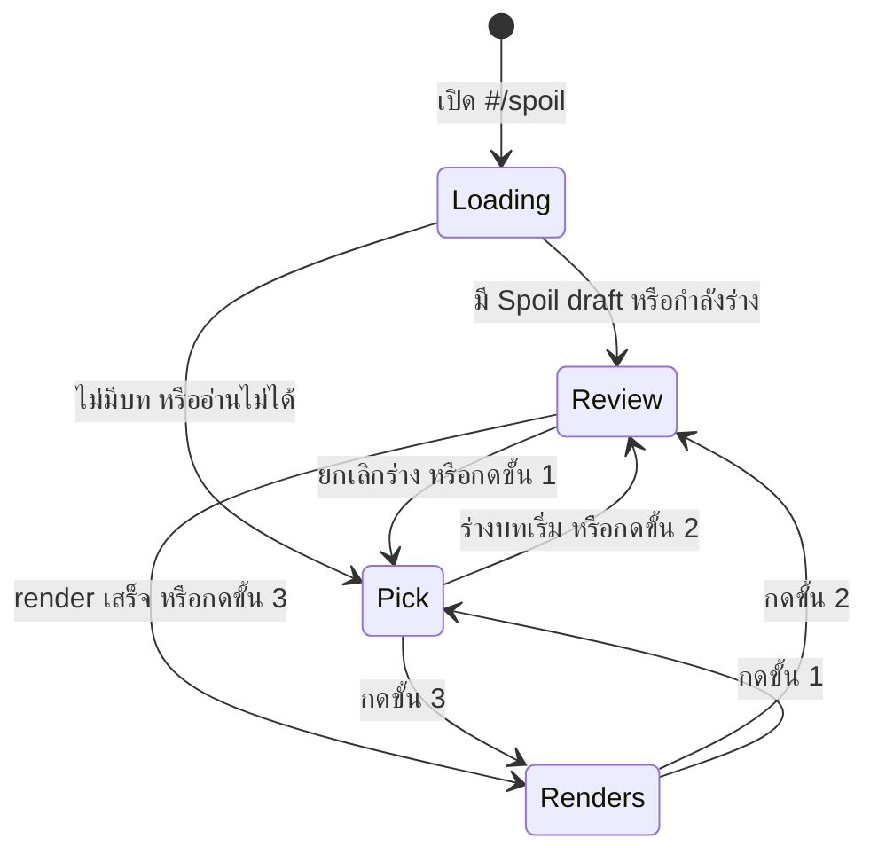
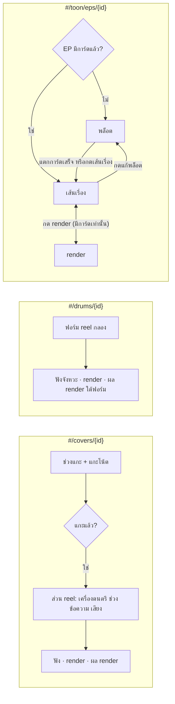

# Flow: nav-ia

## จาก hash ถึงหน้า

ทุกครั้งที่อ่าน hash (โหลดหน้าและ `hashchange`) hash เก่าถูกแทนก่อน แล้วหัวข้อกับหน้าจึงถูกเลือก (D1, D9). เมนูอ่านแค่ hash กับ `NAV_SECTIONS` ตายตัว: ไม่มีล่าสุด และหน้าไม่เขียนอะไรให้เมนู (D22).

## พื้นที่ทำงานสปอย

ขั้นเป็น state ของหน้า `#/spoil` ไม่ใช่ route (D5).

## หน้างานชิ้นเดียว

เพลง reel กลอง และ EP ทำงานในหน้าเดียวจนได้ผล render (D6, D7, D8).

