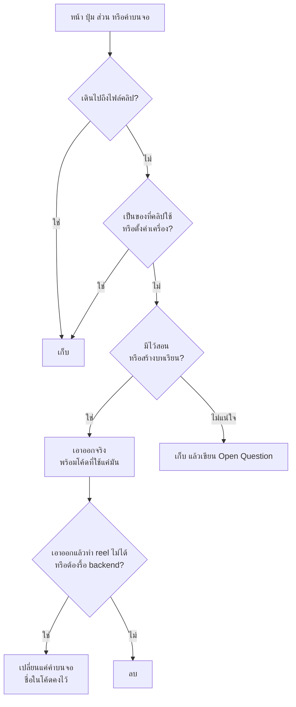
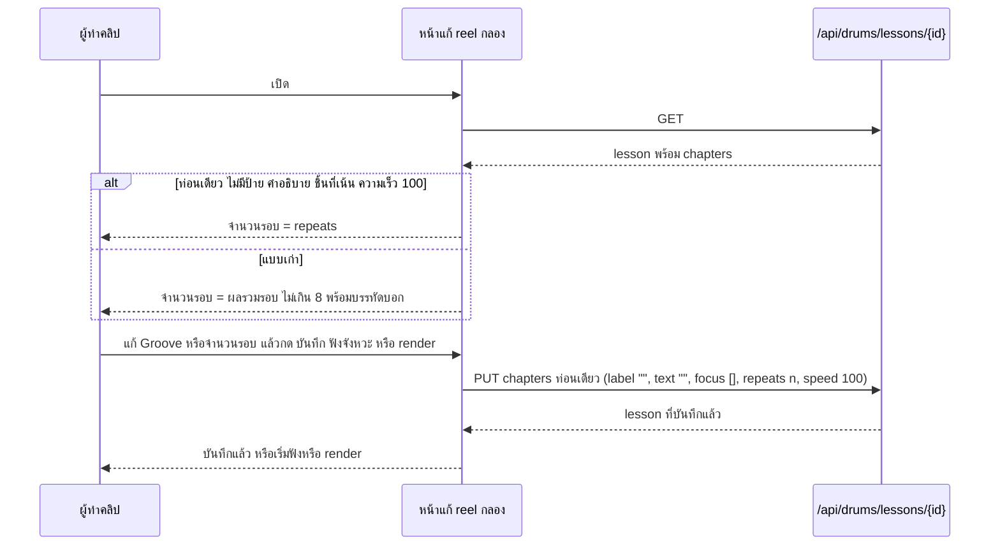

# Flow: reels-only

2 diagrams, read in this order:
1. เกณฑ์ที่ใช้ตัดสินว่าอะไรเก็บอะไรเอาออก
2. หน้าแก้ reel กลองเปิดและบันทึก `chapters` อย่างไร

All diagrams use the same names as [spec.md](spec.md).

## 1. เก็บหรือเอาออก

**ทำไมสอนกลองเหลือหน้าเดิมแต่ท่อนสอนหายไป**
- หน้า `#/drums` ได้ mp4 จึงเก็บ ส่วนท่อนสอนมีไว้สอนจึงออก (D1, D2)
- `lesson` ในโค้ดตกช่อง "ต้องรื้อ backend" จึงเปลี่ยนแค่คำ (D8)
- แถบห้องที่พบในหน้าเพลงมีไว้เลือกห้องของบทเรียนเท่านั้น จึงออก (D6)
- ไม่มีช่อง "ไม่แน่ใจ" ในงานนี้: ตรวจทุกหน้าแล้ว (D9)

## 2. reel กลอง: เปิดและบันทึก

**reel แบบเก่าถูกเขียนใหม่เมื่อไหร่**
- เฉพาะเมื่อผู้ใช้กดสิ่งที่บันทึก; เปิดดูเฉย ๆ ไม่มี `PUT` (D4)
- ฟังจังหวะกับ render บันทึกก่อนเสมอ (video-gen D14, D22)
- ผล render เก่าไม่แตะ (D4)
- คลิปเริ่มที่ห้องแรกของ Groove ไม่มีนับเข้า (D15)
