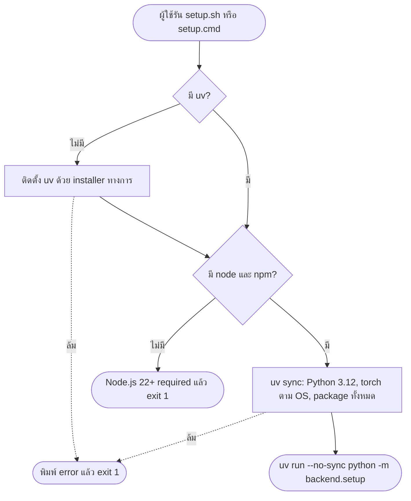
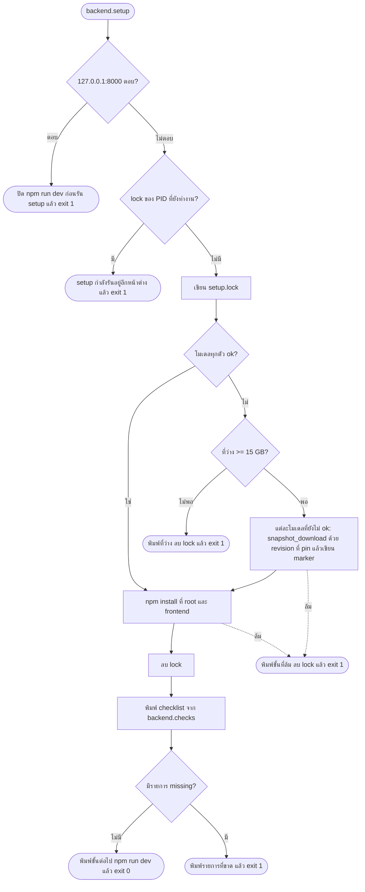
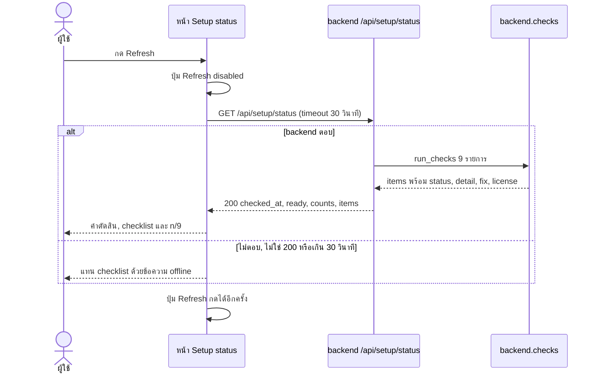

# Flow: setup-status

2 diagrams, read in this order:
1. Setup script ติดตั้งอะไรตามลำดับไหน และหยุดตรงไหน
2. กด Refresh แล้วหน้าเว็บได้ checklist หรือ offline อย่างไร

All diagrams use the same names as [spec.md](spec.md).

## 1. Setup script

### 1.1 Wrapper

### 1.2 backend.setup

**Setup script ทำอะไรตามลำดับไหน และหยุดตรงไหน**
- รันซ้ำได้ทุกครั้ง: โมเดลที่ `ok` ถูกข้าม, ที่ค้างโหลดต่อ (D3, D13)
- marker เขียนหลังโหลดเสร็จเท่านั้น ไม่มี marker = แถวโมเดลเป็น `missing` (D7)
- ล้มกลางทางไม่ลบสิ่งที่โหลดมาแล้ว
- Windows เข้าทาง `setup.cmd` ที่ bypass execution policy (D13)
- torch และ torchaudio เลือก index `cu128` บน Windows จาก `pyproject.toml` (D5, D13)

## 2. Refresh

**กด Refresh แล้วได้ checklist หรือ offline อย่างไร**
- เปิดหน้าครั้งแรกเรียก API เหมือนกด Refresh หนึ่งครั้ง. ไม่ poll (D7)
- เช็คไม่ใช้ network และไม่โหลดโมเดล (D7)
- device cache เฉพาะผล `cuda` หรือ `mps` (D13)
- รายการหนึ่งพังไม่ทำให้รายการอื่นหาย: รายการนั้นเป็น `missing`
