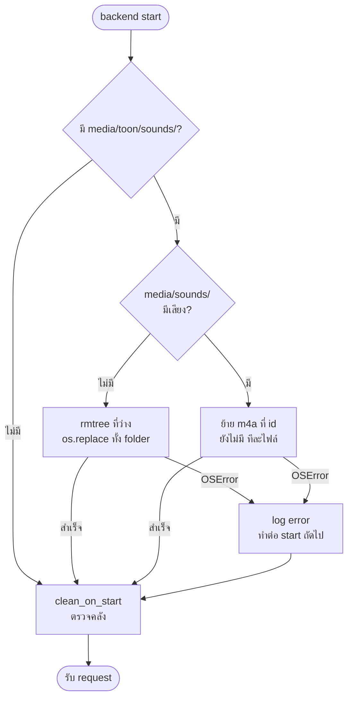
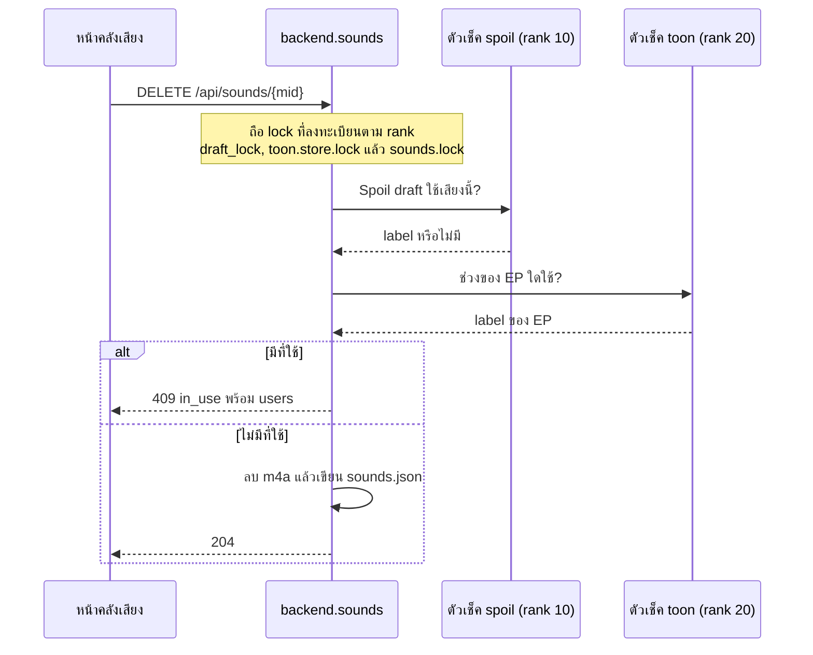
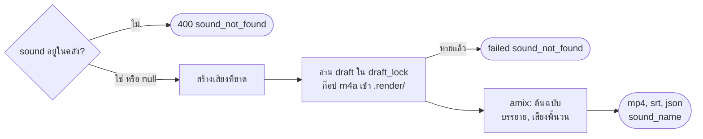

# Flow: sound-library

3 diagrams, read in this order:
1. ย้ายคลังเสียงจาก `media/toon/sounds/` ตอน start
2. ลบเสียงกับตัวเช็คของการ์ตูนเล่าและสปอย
3. Render job ของสปอยผสมเสียงพื้น

All diagrams use the same names as [spec.md](spec.md).

## 1. ย้ายคลังเสียงตอน start

**เสียงที่เอาเข้าไว้แล้วมาอยู่ที่ `media/sounds/` ได้ยังไง**
- "มีเสียง" = มี `sounds.json` หรือ `*.m4a`; `.partial/` อย่างเดียวนับว่าไม่มี (D6, D10)
- ทำซ้ำได้ทุก start: id ที่ย้ายแล้วไม่ย้ายซ้ำ; id ของเสียงไม่เปลี่ยน ช่วงของ EP จึงชี้ถูก (D10)
- ยังเหลือ m4a ที่เดิม → `GET /api/sounds/legacy` และ Alert บนหน้าคลังเสียง (D10)
- การตรวจคลังหลังย้ายตาม toon D70 และ D71

## 2. ลบเสียง

**ทำไมลบเสียงที่ใช้อยู่ไม่ได้ และไม่มีใครเลือกเสียงที่กำลังลบได้**
- feature ลงทะเบียน `(rank, lock, check)` ตอน import; `backend.sounds` ไม่ import toon หรือ spoil_maker (D7, D11, ADR-0033)
- ตัวเช็คถูกเรียกขณะถือ lock ทั้งหมดแล้ว ไม่ acquire เอง (D11)
- `PATCH` ช่วง, Cards job และ `PATCH /draft` เช็ค `sounds.exists` ใต้ lock ของ feature: ลำดับเดียวกัน จึงไม่ deadlock (D11)
- `users` เรียง toon ก่อน spoil ตาม spec › API ไม่ขึ้นกับลำดับที่เรียกตัวเช็ค
- ลบ m4a ก่อน json: crash ระหว่างนั้นถูกเก็บตอน start (toon D70)

## 3. Render job ของสปอยกับเสียงพื้น

**เสียงพื้นเข้าไปในคลิปสปอยยังไง**
- `sound` `null` → ไม่ก๊อปและ filter graph เดิมทุกตัวอักษร (D5)
- ffmpeg อ่านสำเนาใน `.render/` จึงลบเสียงจากคลังระหว่าง render ได้ (D12)
- เสียงพื้น `-stream_loop -1` คูณ `volume / 100` ตัดที่ความยาววิดีโอ (D5)
- เสียงหายจากคลังได้ทางเดียวคือการตรวจคลังตอน start; หน้าตรวจแก้แสดงเป็น Alert (D8, D13)

แผนภาพ 1 สร้างคลังที่แผนภาพ 2 และ 3 อ่าน; Render job ในแผนภาพ 3 ไม่อยู่ในตัวเช็คของแผนภาพ 2 เพราะใช้สำเนา.
