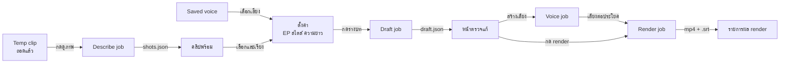
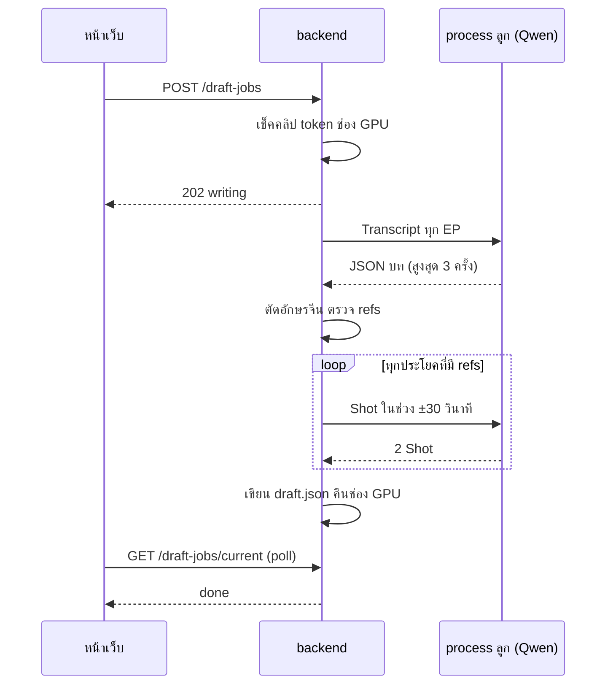
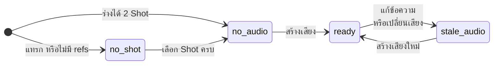
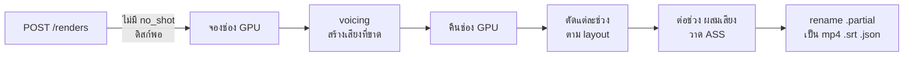
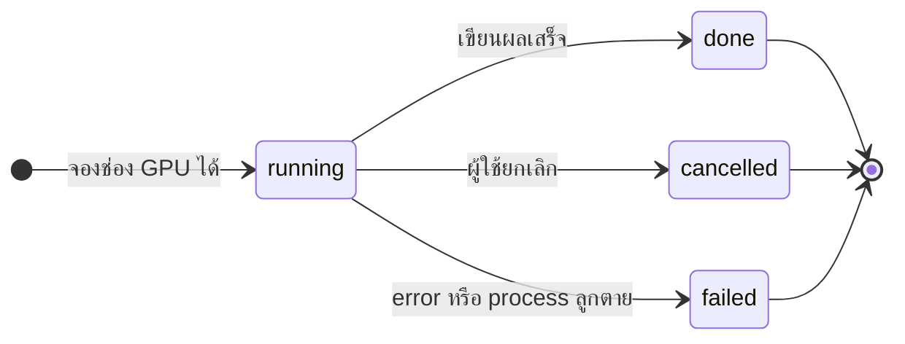

# Flow: spoil-maker

5 diagrams, read in this order:
1. เส้นทางของผู้ใช้ตั้งแต่ Temp clip ถึงผล render
2. Draft job: ใครเรียกใครระหว่างร่างบท
3. สถานะของประโยคใน Spoil draft
4. Render job: ขั้นจากกด render ถึงไฟล์
5. state ของงาน GPU ทุกชนิด

All diagrams use the same names as [spec.md](spec.md). Diagram 1 is the map; 2–4 zoom into its steps; 5 is the lifecycle every job in 1 shares.

## 1. เส้นทางของผู้ใช้

**ผู้ใช้ทำคลิปสปอยหนึ่งคลิปผ่านขั้นไหนบ้าง**
- Describe job ทำครั้งเดียวต่อคลิป ใช้ราว 45 นาทีต่อหนัง 96 นาที (D16, D18)
- Saved voice สร้างก่อนครั้งเดียว ใช้ซ้ำทุกคลิป (D32)
- สร้างเสียงก่อนก็ได้ ข้ามไปกด render ก็ได้: render สร้างเสียงที่ขาดให้ (D30)
- กดร่างบทตอนมี Spoil draft อยู่ต้องยืนยันทับ (D28)
- ทุกงานในภาพนี้ใช้ช่อง GPU เดียวกัน: ดู diagram 5 (D45)
- ถอดใหม่หรือดูภาพใหม่ของคลิปใน Spoil draft ลบ Spoil draft หลังยืนยัน (D49)

## 2. Draft job

**ร่างบทกับเลือก Shot ต่อกันในงานเดียวอย่างไร**
- JSON พังหรือความยาวนอก ±25% สั่งใหม่ได้รวม 3 ครั้ง; ไม่มีผลที่อ่านได้เลย = `draft_failed` (D18)
- token รวมเกิน 32,000 ไม่เริ่มงาน: `400` `transcript_too_long` (D46)
- ประโยคที่ไม่มี refs ข้ามขั้นเลือก Shot ได้ `[null, null]` (D18, D26)
- ยกเลิกหรือ crash ก่อนเขียน draft.json: Spoil draft เดิมไม่เปลี่ยน
- `kind: "pick"` ทำเฉพาะ loop กับประโยคเดียว (D25)

## 3. สถานะของประโยค

**ประโยคหนึ่งพร้อม render เมื่อไร**
- สถานะคำนวณตอนอ่านจาก `shots`, `audio` และข้อความปัจจุบัน ไม่เก็บในไฟล์ (D30)
- `no_shot` render ไม่ได้; `no_audio` กับ `stale_audio` render สร้างเสียงให้ก่อน (D30)
- แก้ข้อความกลับเป็นข้อความเดิม: `stale_audio` กลับเป็น `ready` เอง เพราะเทียบข้อความหลังแปลงตัวเลข (D36)
- ล้าง Shot ช่องใดช่องหนึ่งให้ว่างจากสถานะไหนก็ได้ กลับเป็น `no_shot` (ไม่ได้วาดเส้น)

## 4. Render job

**จากกด render ถึงไฟล์ในรายการผล render**
- ไม่มีประโยคที่ขาดเสียง ข้ามการจองช่อง GPU และ `voicing` ไปตัดช่วงเลย (D30)
- ช่วง ffmpeg ไม่ถือช่อง GPU: งาน GPU อื่นเริ่มได้ระหว่างนั้น (D51)
- เสียงประโยคยาว N แบ่ง Shot ละ N/2 เล่นจากต้น Shot; เลยท้ายต้นฉบับค้างเฟรมสุดท้าย (D31, D45)
- ที่ว่างน้อยกว่า 1 GiB หรือมีประโยค `no_shot`: `POST /renders` ตอบ error ทันที ไม่มีงานเกิดขึ้น (`507` `disk_full`, `400` `missing_shots`)
- ยกเลิกระหว่างตัดหรือต่อ: ฆ่า ffmpeg ลบ `.partial` และ `.render/`
- ผล render ใหม่ไม่ทับของเก่า (D42)

## 5. state ของงาน GPU

**งาน GPU ทุกชนิดเริ่มและจบอย่างไร**
- `running` แทน state ย่อยของแต่ละงาน: `cutting`, `describing`, `writing`, `matching`, `voicing`, `rendering`
- จองไม่ได้ไม่มี state: ได้ `409` `gpu_busy` ทันที พร้อม `running` (D45)
- ทุกทางออกคืนช่อง GPU (D45); Render job คืนก่อนนั้นเมื่อจบ `voicing` (D51)
- คำขอที่ไม่ผ่านการเช็ค (`400`, `404`, `409`, `503`, `507`) ไม่สร้างงาน
- งานทั้งหมดอยู่ใน memory หายเมื่อ backend restart (ADR-0010)
- Download job ของ spoil ไม่ใช้ช่องนี้ (spoil D24)
