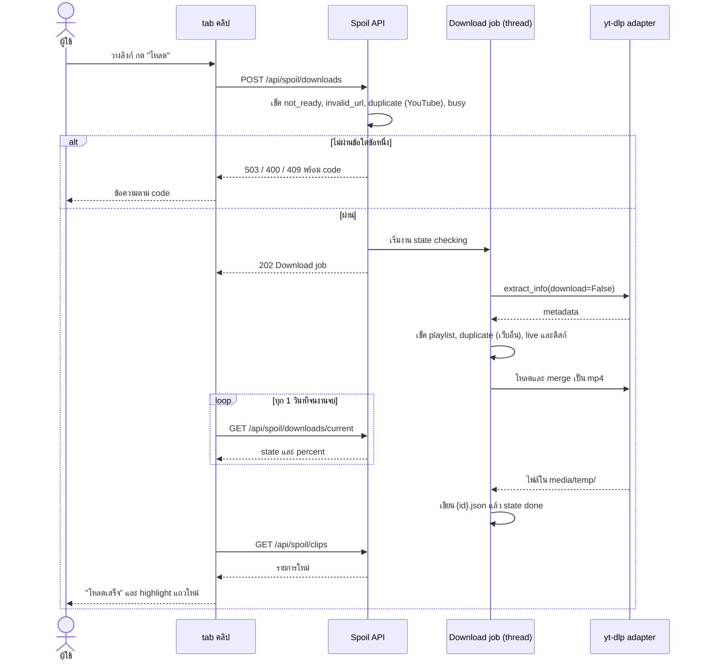
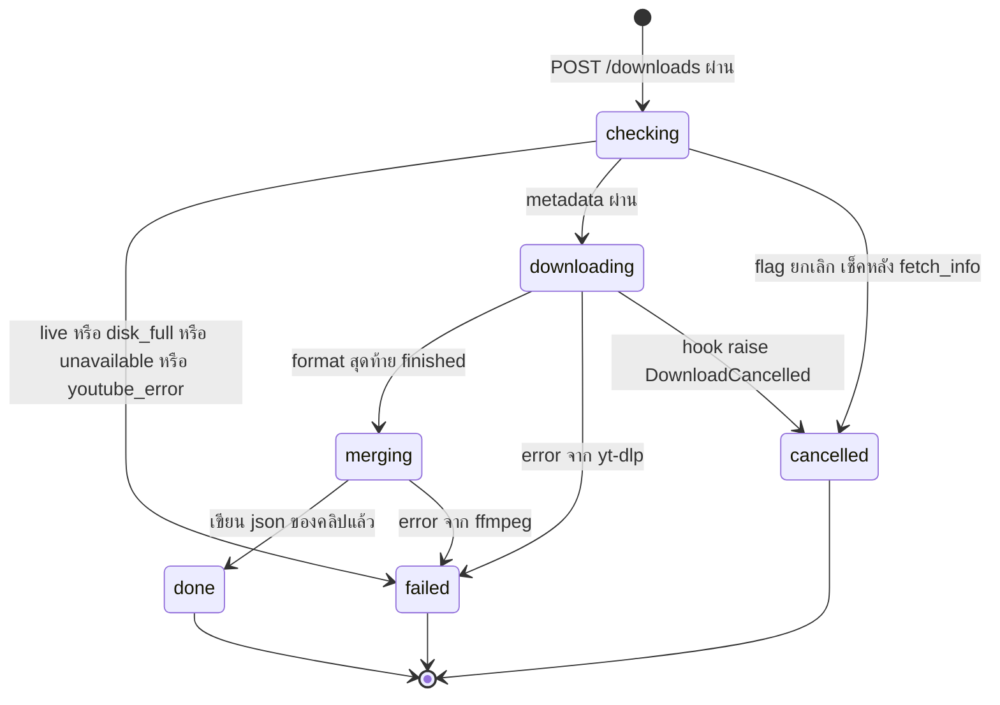
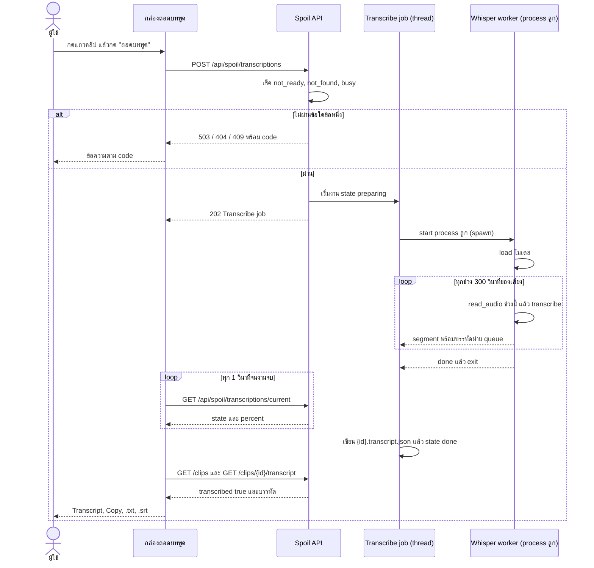
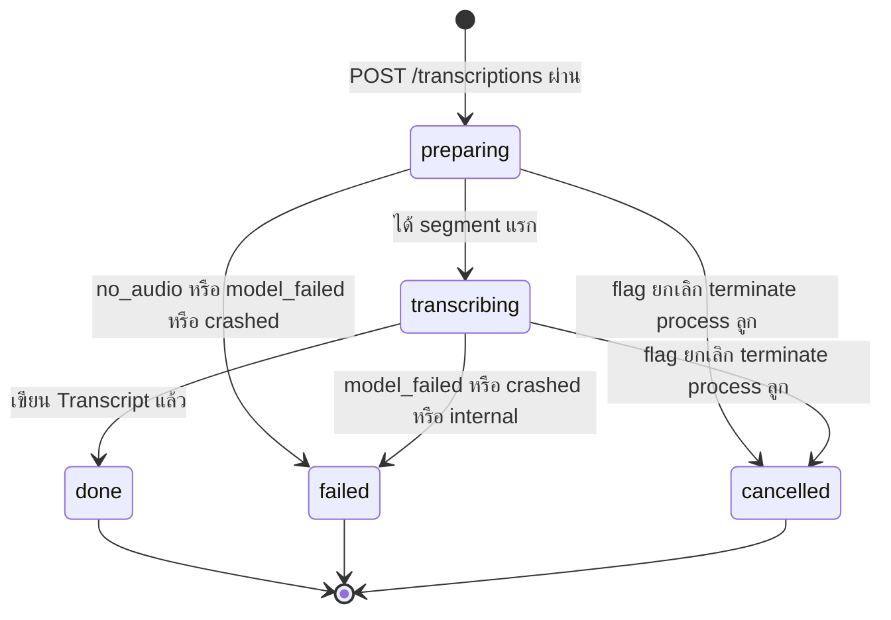
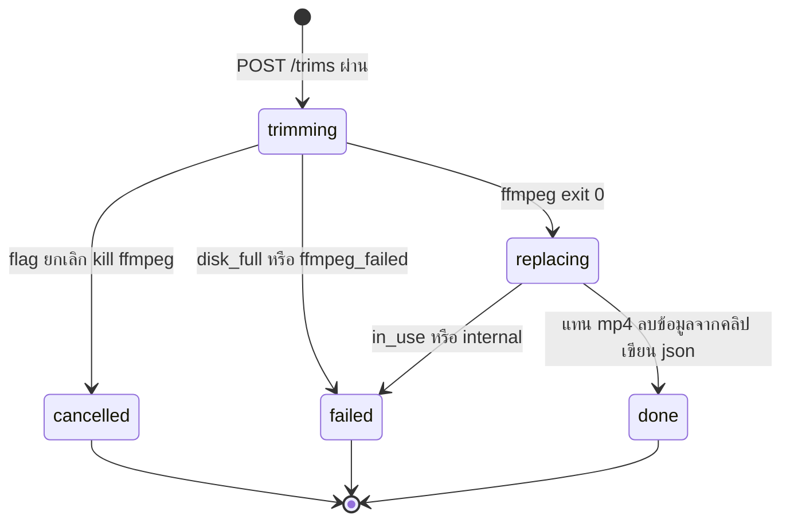
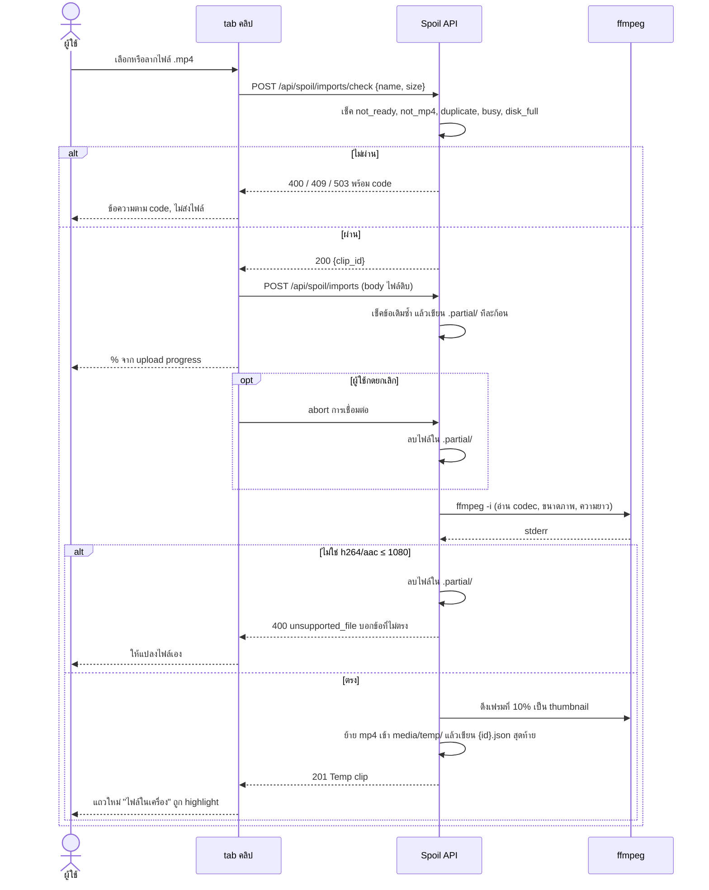

# Flow: spoil

6 diagrams, read in this order:
1. ผู้ใช้วางลิงก์จนได้ Temp clip: หน้าเว็บ, API, Download job และ yt-dlp คุยกันยังไง
2. state ของ Download job และสิ่งที่เกิดกับไฟล์ในแต่ละทาง
3. ผู้ใช้เลือกคลิปแล้วกดถอดจนเห็น Transcript
4. state ของ Transcribe job และสิ่งที่เกิดกับ Transcript ในแต่ละทาง
5. state ของ Trim job และสิ่งที่เกิดกับ mp4 และข้อมูลจากคลิปในแต่ละทาง — ตัดก่อนถอด แล้ว diagram 3 อ่านไฟล์ที่ตัดแล้ว
6. ผู้ใช้เลือกไฟล์ mp4 ในเครื่องจนได้ Temp clip (File import) — ทางที่สองของ diagram 1

All diagrams use the same names as [spec.md](spec.md).

## 1. วางลิงก์จนได้ Temp clip

**ใครทำอะไร ตั้งแต่กดโหลดจนเห็นแถวใหม่**
- ทุกเช็คใน POST ไม่ใช้ network; probe แค่ `yt_dlp`, `deno`, `ffmpeg` (D9, D14)
- มีงานได้ทีละงาน เช็คภายใต้ lock เดียว งานที่สองได้ `409` `busy` (D6, D15)
- ยกเลิก = `DELETE /api/spoil/downloads/current`; ผลต่อแต่ละ state อยู่ใน diagram 2 (D15)
- restart backend ระหว่างงาน → งานหาย; start ใหม่ล้าง `.partial/` และ `{id}.*` ที่ไม่มี json (D14, D15)

## 2. state ของ Download job

**งานจบได้สามทาง และแต่ละทางเหลือไฟล์อะไร**
- `done`: `{id}.mp4`, `{id}.json` และ thumbnail อยู่ใน `media/temp/` (D14)
- `failed` และ `cancelled`: ลบไฟล์ของ id นี้ใน `.partial/` และ `{id}.mp4` ที่ยังไม่มี json คู่ (D14)
- งานที่จบแล้วยังตอบใน `GET /downloads/current` จนมีงานใหม่ (D6)
- `merging` ยกเลิกไม่ได้: `DELETE /downloads/current` ได้ `409` `merging` (D15)
- งานนับว่าจบเมื่อ thread ออก ไม่ใช่ตอนได้ `DELETE` (D15)

## 3. เลือกคลิปแล้วถอดจนเห็น Transcript

**ใครทำอะไร ตั้งแต่กดถอดจนเห็น Transcript**
- gate ใช้แถว `torch`, `transformers`, `ffmpeg`, `model_whisper` และ `device` ไม่ใช่ `cpu` (D27)
- Download job ไม่ทำให้ได้ `busy`; งานถอดสองงานทำให้ได้ (D24)
- ถอดใน process ลูก: crash ไม่ล้ม backend และงานโหลด, memory คืนเมื่อ process ออก (D28)
- เสียงดึงทีละช่วงเข้า memory ไม่ลงดิสก์; backend เขียน Transcript คนเดียว (D28, D29)
- ยกเลิก = `DELETE /api/spoil/transcriptions/current` แล้ว backend terminate process ลูกทันที (D28)

## 4. state ของ Transcribe job

**งานจบได้สามทาง และ Transcript เป็นอย่างไร**
- `done`: `{id}.transcript.json` ใหม่ทับของเดิม แถวแสดง "ถอดแล้ว" (D23)
- `failed` และ `cancelled`: Transcript เดิม (ถ้ามี) ไม่ถูกแตะ; ทุกทาง process ลูกไม่เหลือ (D28, D29)
- ระหว่างงานยังไม่จบ ลบคลิปนั้นได้ `409` `transcribing` (D27)
- restart backend ระหว่างงาน → งานหาย Transcript เดิมยังอยู่ (ADR-0010)
- หลัง `done` แก้ข้อความทีละบรรทัดได้ด้วย `PATCH /clips/{id}/transcript/lines/{n}`: เวลาและจำนวนบรรทัดไม่เปลี่ยน บรรทัดได้ `edited: true`; ระหว่าง Transcribe job ของคลิปนั้น `409` `transcribing`; ถอดใหม่จน `done` ทับที่แก้ไว้ (spoil-maker D54)

## 5. state ของ Trim job

Trim job จาก `POST /trims` จนจบ: ยกเลิกได้เฉพาะตอน `trimming`; ตั้งแต่ `replacing` ไฟล์ถูกแทนจริง (D41).

**งานจบได้สามทาง และ mp4 กับข้อมูลจากคลิปเป็นอย่างไร**
- `done`: `{id}.mp4` เป็นไฟล์ใหม่; Transcript, Shot, การตัด EP และ Spoil draft ของคลิปหาย; json มี `duration_s` ใหม่และ `trimmed` (D36, D37)
- `cancelled` และ `failed`: mp4 และข้อมูลเดิมไม่ถูกแตะ; ไฟล์ใน `.partial/` ถูกลบ (D41)
- ระหว่างงานยังไม่จบ ถอด แก้บรรทัด และลบคลิปนั้นได้ `409` `trimming`; งาน spoil-maker ของคลิปนั้นได้ `409` `clip_busy` (D41)
- restart backend ระหว่าง `replacing` → marker `{id}.trimming.json` ทำให้ start ครั้งหน้าทำต่อหรือย้อนจนครบ (D41)

## 6. เลือกไฟล์ในเครื่องจนได้ Temp clip

