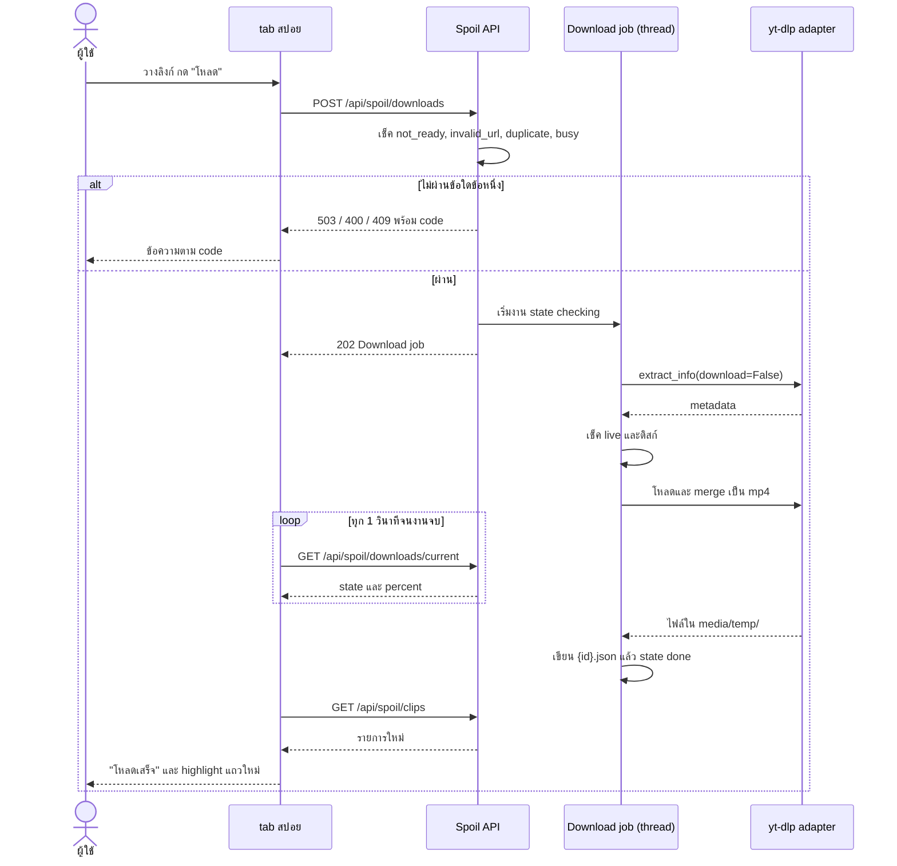
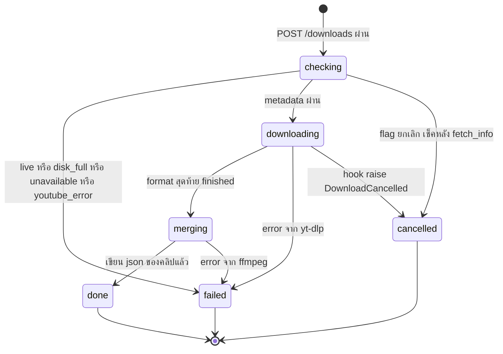

# Flow: spoil

2 diagrams, read in this order:
1. ผู้ใช้วางลิงก์จนได้ Temp clip: หน้าเว็บ, API, Download job และ yt-dlp คุยกันยังไง
2. state ของ Download job และสิ่งที่เกิดกับไฟล์ในแต่ละทาง

All diagrams use the same names as [spec.md](spec.md).

## 1. วางลิงก์จนได้ Temp clip

**ใครทำอะไร ตั้งแต่กดโหลดจนเห็นแถวใหม่**
- ทุกเช็คใน POST ไม่ใช้ network; probe แค่ `yt_dlp`, `deno`, `ffmpeg` (D9, D14)
- มีงานได้ทีละงาน เช็คภายใต้ lock เดียว งานที่สองได้ `409` `busy` (D6, D15)
- ยกเลิก = `DELETE /api/spoil/downloads/current`; ผลต่อแต่ละ state อยู่ใน diagram 2 (D15)
- restart backend ระหว่างงาน → งานหาย; start ใหม่ล้าง `.partial/` และ `{id}.*` ที่ไม่มี json (D14, D15)

## 2. state ของ Download job

**งานจบได้สามทาง และแต่ละทางเหลือไฟล์อะไร**
- `done`: `{id}.mp4`, `{id}.json` และ thumbnail อยู่ใน `media/temp/` (D14)
- `failed` และ `cancelled`: ลบไฟล์ของ id นี้ใน `.partial/` และ `{id}.mp4` ที่ยังไม่มี json คู่ (D14)
- งานที่จบแล้วยังตอบใน `GET /downloads/current` จนมีงานใหม่ (D6)
- `merging` ยกเลิกไม่ได้: `DELETE /downloads/current` ได้ `409` `merging` (D15)
- งานนับว่าจบเมื่อ thread ออก ไม่ใช่ตอนได้ `DELETE` (D15)
