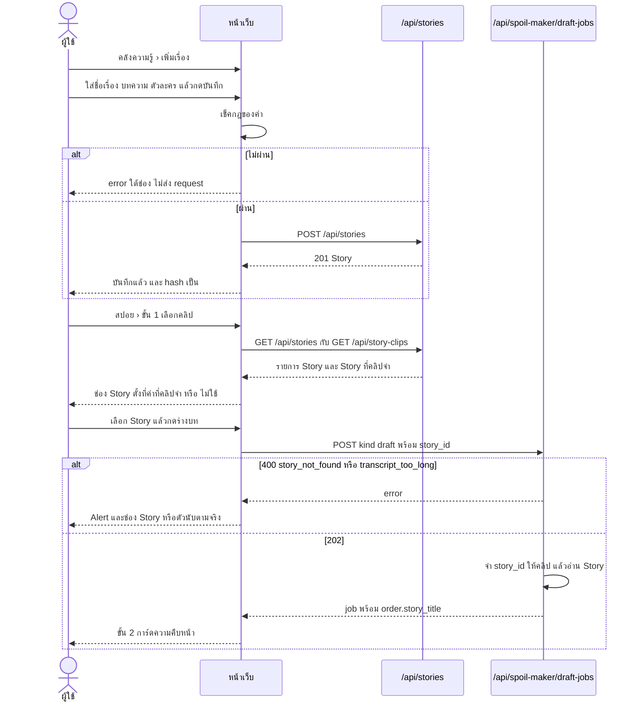
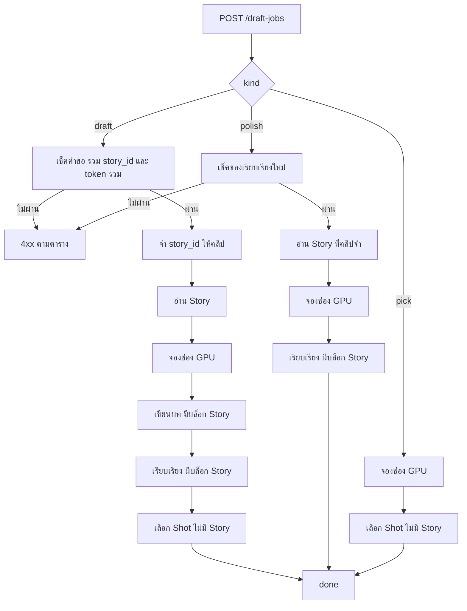

# Flow: story-kb

2 diagrams, read in this order:
1. ผู้ใช้สร้าง Story แล้วใช้กับคลิปตอนกดร่างบท
2. Draft job แต่ละ `kind` ใช้ Story อย่างไร

All diagrams use the same names as [spec.md](spec.md).

## 1. สร้าง Story แล้วใช้ตอนกดร่าง

**ผู้ใช้ทำอะไร และคลิปจำ Story เมื่อไหร่**
- เปลี่ยนช่อง Story ไม่ส่ง request; จำตอนกดร่างเท่านั้น (D15)
- token ของ EP กับ Story รวมกันไม่เกิน 32,000 (D14)
- ลบคลิปลบ Story ที่คลิปจำ; ตัดช่วงหรือถอดใหม่ไม่ลบ (D7)
- ลบ Story ลบทุก key ที่ชี้มัน (D10)

## 2. Draft job ใช้ Story

**งานไหนใช้ Story และอ่านเมื่อไหร่**
- อ่านครั้งเดียวตอนรับคำขอ; แก้หรือลบ Story ระหว่างงานไม่กระทบงานนั้น (D5, D10)
- ไม่มี Story หรือไฟล์เสีย → ไม่มีบล็อก คำสั่งเหมือนเดิม (spec › คำสั่ง LLM)
- บล็อก Story บอกว่าเหตุการณ์ต้องมาจาก Transcript เท่านั้น (D8)
- ตำแหน่งบล็อกในแต่ละคำสั่ง (D16)
