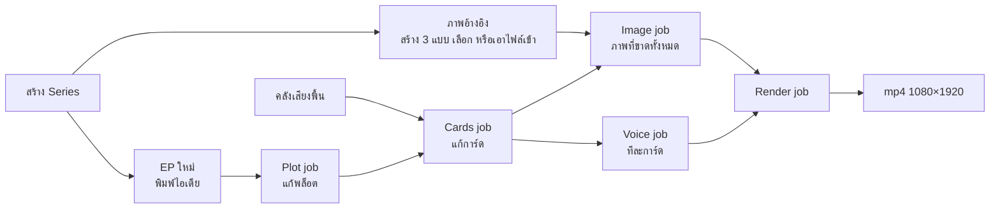
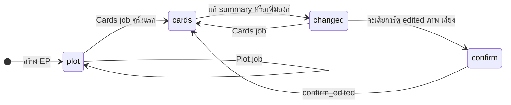
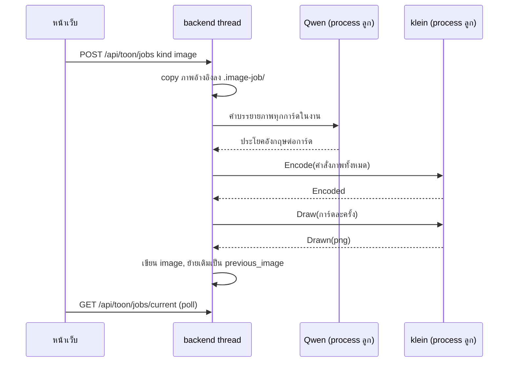
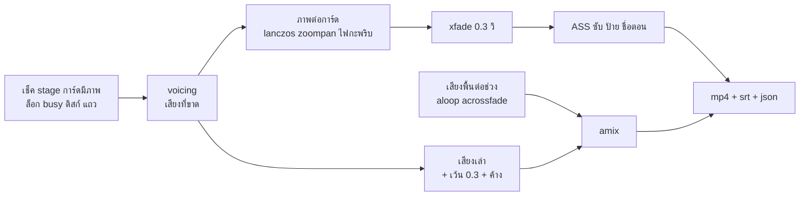

# Flow: toon

4 diagrams, read in this order:
1. ทางของผู้ใช้ตั้งแต่สร้าง Series จนได้ mp4
2. ขั้นของ EP กับการแตกใหม่
3. Image job: Qwen แปล แล้ว klein สร้างทีละภาพ
4. Render job: จากการ์ดเป็น mp4

All diagrams use the same names as [spec.md](spec.md).

## 1. ทางของผู้ใช้

**ผู้ใช้ต้องทำอะไรก่อนได้คลิป**
- ภาพอ้างอิงทำก่อนหรือหลังพล็อตก็ได้; ของใหม่จากพล็อตเข้า Series ตอน Cards job ครั้งแรก ยังไม่มีภาพ (D13)
- การ์ดที่ใช้ของที่ไม่มีภาพอ้างอิงถูกข้ามใน Image job และนับใน `skipped` (D33)
- Voice job ข้ามได้: Render job สร้างเสียงที่ขาดให้ (D38)
- AI เลือกเสียงพื้นจากชื่อในคลังตอน Cards job; render ผสมเสียงต่อช่วง (D5, D17)
- ทุกงานที่โหลดโมเดลจองช่อง GPU ช่องเดียวของ backend (ADR-0015); Render job มี slot ของตัวเอง (D45)

## 2. ขั้นของ EP

**เมื่อไหร่ AI เขียนทับการ์ด**
- `changed` = มีองก์ที่ `summary` ≠ `cards_from` หรือ `cards_from` `null` (องก์ที่เพิ่มหลังยืนยัน); Cards job แตกเฉพาะองก์เหล่านั้น (D15)
- `confirm`: Cards job ได้ `409` `cards_will_be_lost` พร้อมจำนวนต่อองก์ จนกว่าส่ง `confirm_loss: true` (D43)
- องก์ที่แตกใหม่เสียภาพและเสียงของการ์ดเดิม; องก์อื่นไม่เปลี่ยน (D15)
- Plot job ใช้ได้เฉพาะ `stage` `plot`; หลังนั้นผู้ใช้แก้พล็อตเอง (`409` `plot_confirmed`)

## 3. Image job

**ทำไม memory พอบนเครื่อง 16 GB**
- Qwen จบ process ก่อน klein เริ่ม; ในขั้น klein ปล่อย text encoder ก่อนโหลด transformer GGUF (D34, D36)
- คำบรรยายภาพที่ใช้คือของ ณ ตอนเริ่มงาน (D36)
- ยกเลิก: หยุดหลังภาพที่กำลังสร้าง ภาพที่เสร็จแล้วอยู่ (D33)
- การ์ดที่ถูกลบหรือแตกใหม่ระหว่างงาน: ภาพที่ได้ถูกทิ้ง; `Draw` ล้มหนึ่งการ์ด: นับใน `failed_cards` แล้วไปต่อ

## 4. Render job

**จากการ์ดเป็นคลิป**
- `voicing` จองช่อง GPU เฉพาะเมื่อมีการ์ด `no_audio` หรือ `stale_audio`; ไม่มีก็ข้าม (D38)
- การ์ดไม่มีภาพ → `400` `cards_not_ready` ก่อนเริ่ม; `stale_ref` render ได้ด้วยภาพเดิม (D32)
- ช่วงที่ติดกันใช้เสียงพื้นเดียวกันเล่นต่อไม่เริ่มใหม่ (D17)
- ป้ายชื่อขึ้นตลอดการ์ดแรกที่ตัวละครออกเมื่อ `name_tags` เปิด (D19, D23)
- `rendering` อ่าน EP ครั้งเดียวและ copy ไฟล์ลง `.render/`; json ของผล render เขียนหลังสุด; ยกเลิกหรือ restart ลบ `.partial` และ `.render/` (spec › Render job)
