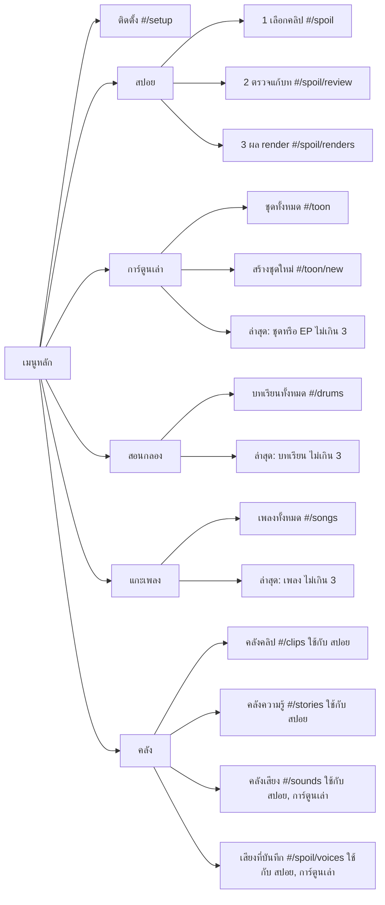
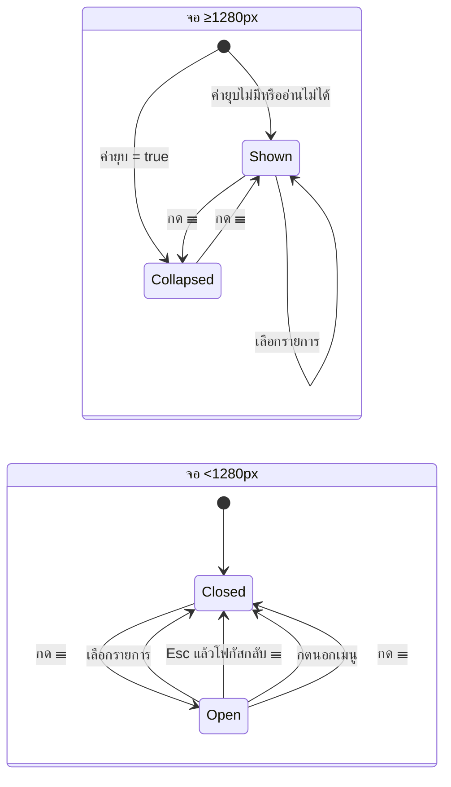
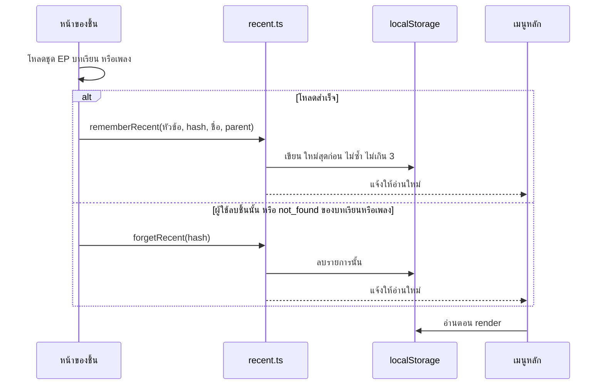

# Flow: ui-nav

3 diagrams, read in this order:
1. เมนูหลักมีอะไร และแต่ละรายการพาไป hash ไหน
2. ปุ่ม ☰ เปิดและปิดเมนูอย่างไรบนสองจอ
3. ล่าสุดถูกเขียนและลบเมื่อไร

All diagrams use the same names as [spec.md](spec.md).

## 1. ต้นไม้เมนูหลัก

**เมนูมีกี่ชั้น และกดอะไรแล้วไปไหน**
- ทุกปลายทางอยู่ลึกไม่เกินสองชั้นจากเมนู: หัวข้อ → รายการ (D3)
- หัวข้อที่มีรายการเป็นหัวกลุ่ม ไม่ใช่ลิงก์; ติดตั้งเป็นลิงก์เอง (D3)
- รายการที่เปิดอยู่หาจาก hash ด้วย prefix ที่ยาวที่สุด (D6)
- ล่าสุดไม่มี = ไม่มีหัวเล็ก "ล่าสุด" ใต้หัวข้อนั้น (D5)

## 2. เปิดและปิดเมนู

**ปุ่ม ☰ ทำอะไรบนแต่ละจอ**
- เป็น `<nav>` ตัวเดียว ปุ่มเดียว; `aria-expanded` บอกว่าเมนูเห็นอยู่หรือไม่บนจอนั้น (D4)
- ค่ายุบเก็บใน `framecraft.nav.collapsed` เฉพาะจอกว้าง; drawer ของจอแคบปิดทุกครั้งที่ load (D4)
- ข้ามจุดแบ่งระหว่างเปิดหน้า: drawer ที่เปิดอยู่ปิด แล้วใช้ค่ายุบของจอกว้าง (D4)
- เลือกรายการขณะมีงานไม่บันทึก: leave guard ถามก่อน hash เปลี่ยน; drawer ปิดไม่ว่าตอบอะไร (D6, D10)
- drawer เปิด: โฟกัสไปรายการที่เปิดอยู่ หน้าข้างหลัง `inert`; ปิดด้วยการเลือกหรือ `Esc` โฟกัสกลับ ☰ (D10)

## 3. ล่าสุด

**ล่าสุดเปลี่ยนเมื่อไร**
- หน้าย่อย (`/cast`, `/render`, `/renders`, `/cover`, …) ไม่เขียน แต่เน้นล่าสุดของชิ้นแม่ (D11)
- การ์ตูนเล่าลบล่าสุดได้ทางลบเท่านั้น; ลบชุดลบ EP ของมันด้วย (D11)
- `localStorage` โยนหรือ JSON เสีย = ไม่มีล่าสุด ไม่มี error บนจอ (D5)
- แท็บอื่นเปลี่ยนค่า → event `storage` ให้เมนูอ่านใหม่ (D5)
