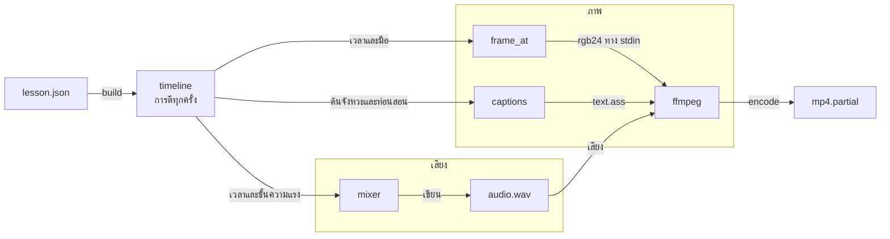
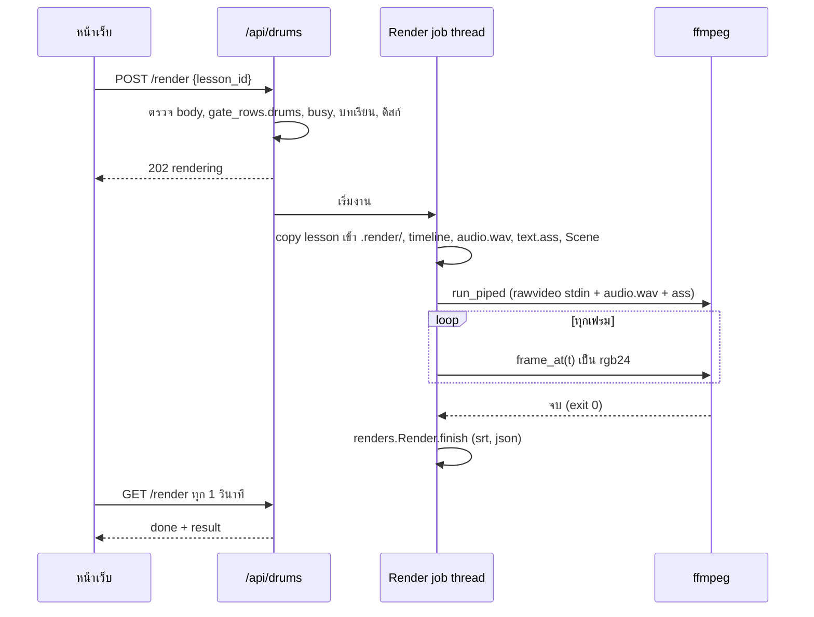
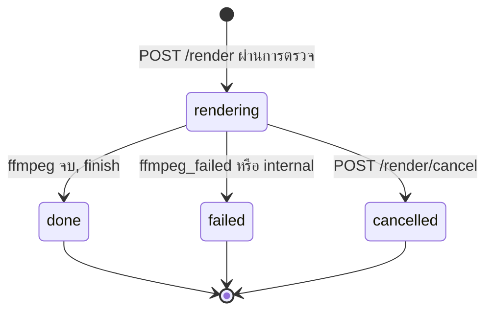

# Flow: video-gen

3 diagrams, read in this order:
1. จากบทเรียนกลองไปเป็นเสียงและภาพ — ทำไมสองอย่างตรงกัน
2. Render job ตั้งแต่กดจนได้ไฟล์
3. state ของ Render job

All diagrams use the same names as [spec.md](spec.md).

## 1. บทเรียนกลองเป็นเสียงและภาพ

**ทำไมเสียงกับภาพตรงกัน: ทุกชั้นอ่านเวลาจาก `timeline` ตัวเดียว**

อ่านซ้ายไปขวา: บทเรียนกลองกลายเป็นตารางเวลาครั้งเดียว แล้วแยกเป็นทางเสียงกับทางภาพที่มาบรรจบกันใน ffmpeg.

- "ฟังจังหวะ" ใช้แค่ทางเสียง (`timeline` → `mixer`) แล้วส่ง wav กลับหน้าเว็บ ไม่มีทางภาพ (D8)
- เวลาปัดเป็น sample ที่ 44.1 kHz ครั้งเดียวใน `timeline` เป้าคลาด ≤ 1 เฟรม (D14, D19)
- ชั้นนิ่ง (พื้นหลัง ชุดกลองต่อชุดชิ้นที่เน้น เส้นเลน) วาดครั้งเดียว `frame_at` วาดแค่ของที่ขยับ (D18)
- ตัวหนังสือทั้งหมดอยู่ใน ASS ไม่ได้วาดด้วย Pillow (D3)

## 2. Render job

**ระหว่างกด render จนได้ไฟล์ เกิดอะไรตามลำดับ**

การตรวจทั้งหมดเกิดก่อน `202`; หลังจากนั้น error มาทาง state ของงานเท่านั้น. ลำดับการตรวจและ error code อยู่ใน spec › Render job.

- งานใช้สำเนาของบทเรียนที่ copy ตอนเริ่ม; แก้ระหว่าง render ไม่มีผลกับงานนี้ (spec › Render job ข้อ 6)
- ไม่จองช่อง GPU; render ระหว่างงาน GPU ของ tab อื่นได้ (D14)
- `percent` = เฟรมที่ส่งให้ ffmpeg แล้ว / `ceil(length_s × 30)` (D21)
- เขียน stdin พังตอนยกเลิกเป็น `cancelled` ไม่ใช่ `failed` (D22)

## 3. state ของ Render job

**งานหนึ่งจบได้สามทาง และไม่กลับมารันอีก**

เริ่มงานใหม่ได้เมื่อ state ไม่ใช่ `rendering`.

- `cancelled` และ `failed` ไม่เหลือไฟล์ `.partial` (spec › Render job)
- restart backend ระหว่าง `rendering`: start ล้าง `.render/` และ `.partial` งานหายจาก `GET /render` (ADR-0010)
