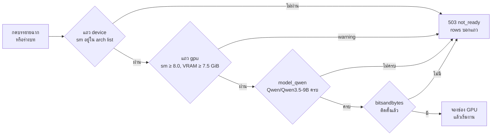
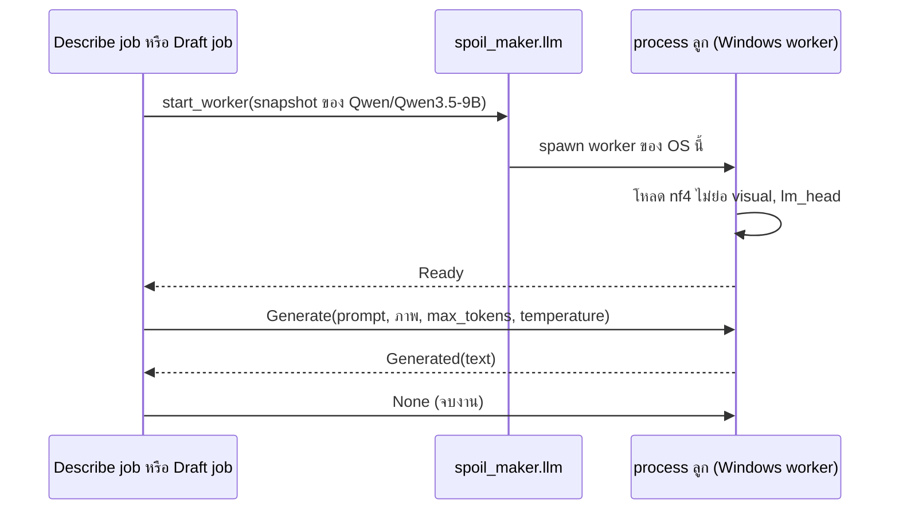

# Flow: windows-launch

2 diagrams, read in this order:
1. งาน Qwen ผ่าน gate บน Windows ได้เมื่อไหร่
2. งาน Qwen คุยกับ worker ของ Windows ยังไง

All diagrams use the same names as [spec.md](spec.md).

## 1. gate ของงาน Qwen บน Windows

**แถวไหนที่ทำให้ Windows เริ่มงาน Qwen ไม่ได้**
- อ่านจากซ้ายไปขวา; ทุกทางที่ไม่ผ่านไปที่ `503` `not_ready` ตัวเดียวกัน ซึ่ง `rows` บอกแถวที่ไม่ผ่านทั้งหมด ไม่ใช่แค่แถวแรก (spoil-maker D56).
- แถว `ffmpeg` เช็คก่อนตามเดิม ไม่ได้วาด.
- แถว `device` กันงานถอดเสียงและสร้างเสียงด้วย ไม่ใช่แค่งาน Qwen (D8).
- `gpu` ที่เป็น `warning` ยังกันงาน แต่ Setup script จบปกติ (D9).
- บน Mac ไม่มีแถว `gpu` และแถวตัวรันเป็น `mlx_vlm` แทน `bitsandbytes` (D6, D8).

## 2. งาน Qwen กับ worker ของ Windows

**ทางเดินของหนึ่งคำขอจากงานถึงโมเดลบน Windows**
- ข้อความ `Generate`, `Ready`, `Generated`, `WorkerError` เหมือน worker ของ Mac ทุกตัว; ต่างกันแค่ worker ที่ `start_worker` เลือกตาม OS (D3).
- การโหลดไม่มี timeout; trial จดเวลาถึง `Ready` (D12).
- แต่ละ `Generate` รอได้ตามค่าต่อ OS ใน spec › ค่าต่อ OS แล้ว terminate process ลูก (D7, D12).
- exception ใน process ลูกส่ง `WorkerError` `model_failed` แล้วออก; process ตายไม่ส่งผล = `crashed` ตามเดิม (spoil D28).
- งานถือช่อง GPU ช่องเดียวตลอด ตาม ADR-0015.
